# 📱 폰 속 AI가 2027 수능을 풀었다

**인터넷 없이 스마트폰·노트북에서 돌아가는 공개 AI 모델 14개에게 2026년 11월 19일 시험 당일 공개된 2027학년도 수능 문제를 풀게 하고 평가원 정답으로 채점했다.**

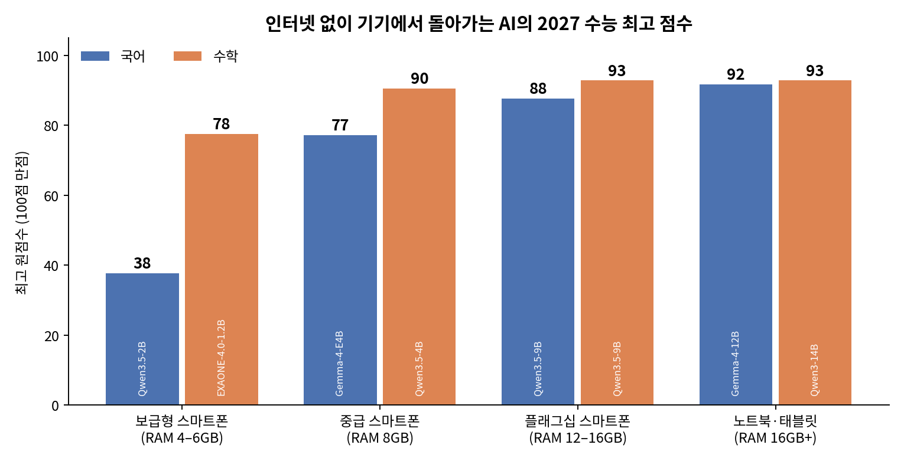

- **가장 높은 점수**: 국어 **92점**(Gemma-4-12B), 수학 **93점**(Qwen3.5-9B), 영어 **94점**(Gemma-4-12B). (100점 만점 원점수, 3회 평균)
- **기기별로 보면** 보급형 스마트폰급 모델은 국어 최고 38점·수학 최고 78점·영어 최고 80점, 중급 스마트폰급 모델은 국어 최고 77점·수학 최고 90점·영어 최고 93점, 플래그십 스마트폰급 모델은 국어 최고 88점·수학 최고 93점·영어 최고 91점, 노트북·태블릿급 모델은 국어 최고 92점·수학 최고 93점·영어 최고 94점이다. (아래 표 참고, 메모리 기준 추정)
- **영어**는 절대평가라 90점 이상이면 1등급이다. 중급 스마트폰에서 돌아가는 4B 모델(Gemma-4-E4B, 93점)부터 1등급 점수가 나왔고, 1등급 점수를 받은 모델은 모두 5개다. 단, 듣기는 음성 대신 대본을 읽고 풀었다.
- **한국사**(50점 만점)는 40점 이상이면 1등급이다. 최고 점수는 Mi:dm-2.0-Base의 46점이다. 플래그십 스마트폰에서 돌아가는 8B 모델(kanana-1.5-8B, 41점)부터 1등급 점수가 나왔고, 1등급 점수를 받은 모델은 모두 2개다.
- **사회탐구**(과목당 50점 만점) 과목별 최고 점수는 생활과 윤리 43점(Gemma-4-12B), 윤리와 사상 38점(Gemma-4-12B), 경제 45점(Qwen3.5-9B), 정치와 법 32점(Gemma-4-12B), 사회·문화 34점(Gemma-4-12B)이다. 도표·그래프는 글로 옮겨 제시했다.
- **1B 이하 모델**은 평균 정답률이 31%로, 5지선다를 무작위로 찍었을 때(20%)보다 조금 나은 수준이다. 생각을 끝내지 못하고 길이 제한에 걸리거나, 답을 정해진 형식으로 쓰지 못하는 경우가 많았다.
- **수학**은 작은 모델도 잘 푼다. 4B 크기의 Gemma-4-E4B가 80점을 넘었다.
- 시험지 맨 끝의 4점 단답형 고난도 문항(공통 21·22번, 선택 29·30번)은 모델 평균 정답률이 22%, 가장 잘 푼 모델도 67%에 그쳤다.
- **국어가 수학보다 어렵다.** 2B 이상 모델 기준으로 국어 정답률이 수학보다 평균 12%p 낮다. 2,000–4,000자 길이의 지문을 읽고 선택지 사이의 미묘한 차이를 가려내는 일이 작은 모델에게는 계산보다 어렵다.
- **국산 모델**: HyperCLOVAX-SEED 0.5B(국어 18점, 수학 19점, 영어 28점), EXAONE-4.0-1.2B(국어 31점, 수학 75점, 영어 63점, 한국사 15점), kanana-2-3B(국어 34점, 수학 39점, 영어 74점, 한국사 33점), A.X-4.0-Light(국어 49점, 수학 56점, 영어 83점, 한국사 32점), kanana-1.5-8B(국어 45점, 수학 42점, 영어 83점, 한국사 41점), Mi:dm-2.0-Base(국어 44점, 수학 54점, 영어 82점, 한국사 46점).

> 마지막 업데이트: 2026-11-20 09:57 KST. 평가가 진행되는 동안 모델 하나가 끝날 때마다 이 페이지가 자동으로 갱신된다.

## 왜 소형 모델인가

올해 수능에서는 스마트 안경·초소형 카메라 같은 첨단 기기를 이용한 부정행위를 막기 위해 시험장 점검이 크게 강화되었다. 통신이 차단되고 기기 검사가 엄격한 시험장에서 인터넷에 연결된 대형 AI(ChatGPT, Claude, Gemini 등)를 쓰는 것은 사실상 불가능하다. 그래서 현실적으로 따져 볼 질문은 **"인터넷 없이 기기 안에서만 돌아가는 작은 AI 모델은 수능을 얼마나 풀 수 있는가"**이다. 이 저장소는 그 질문에 대한 측정 결과이며, 시험 관리와 AI 위험 평가의 참고 자료로 쓰이기를 바란다.

## 용어 메모

<sub>B(billion)는 모델의 매개변수 수다. 0.5B는 5억 개, 14B는 140억 개로, 숫자가 클수록 모델이 크고 대체로 더 똑똑하지만 메모리도 더 많이 필요하다.</sub>

### 어떤 기기에서 돌아갈까

모델을 4비트로 압축(양자화)했을 때 필요한 메모리를 기준으로 대략적인 기기 등급을 나눴다. 스마트폰은 운영체제와 다른 앱이 메모리를 함께 쓰므로 전체 RAM의 절반 정도를 모델에 쓸 수 있다고 가정했다.

| 기기 등급 | 대략적인 기기 사양 | 4비트 가중치 크기 | 해당 모델 | 이 등급 최고 점수 (국어 / 수학 / 영어 / 한국사<sub>50점</sub>) |
|---|---|---|---|---|
| 보급형 스마트폰 | RAM 4–6GB | ≤1.5GB | HyperCLOVAX-SEED 0.5B, Qwen3.5-0.8B, EXAONE-4.0-1.2B, Qwen3.5-2B | 38 / 78 / 80 / 15 |
| 중급 스마트폰 | RAM 8GB | 1.5–3.2GB | Gemma-4-E2B, kanana-2-3B, Gemma-4-E4B, Qwen3.5-4B | 77 / 90 / 93 / 37 |
| 플래그십 스마트폰 | RAM 12–16GB | 3.2–6GB | A.X-4.0-Light, kanana-1.5-8B, Qwen3.5-9B | 88 / 93 / 91 / 41 |
| 노트북·태블릿 | RAM 16GB 이상 | 6GB 이상 | Mi:dm-2.0-Base, Gemma-4-12B, Qwen3-14B | 92 / 93 / 94 / 46 |

<sub>주의: 이 표는 메모리 기준 추정치다. 이번 평가는 압축하지 않은 원래 정밀도로 진행했으므로, 기기에서 4비트로 돌리면 점수가 조금 낮아질 수 있다. 또 스마트폰의 생성 속도는 초당 수~수십 토큰 수준이라, 추론 모드 모델이 한 문항에 수천~1만 토큰을 쓰면 문항당 수 분이 걸린다. 정해진 시험 시간 안에 실제로 풀 수 있는지는 속도까지 함께 봐야 한다.</sub>

## 정답률

정답률은 "문항 × 3회 풀이" 가운데 맞힌 비율로, 배점과 관계없이 모델끼리 비교하기 위한 지표다. 5지선다형을 무작위로 찍으면 20%, 수학 단답형은 0%다.

**정답률 총괄표: 모델 × 문항 유형**

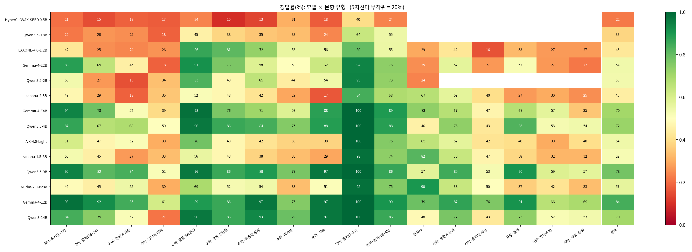

**모델 크기 vs 정답률**

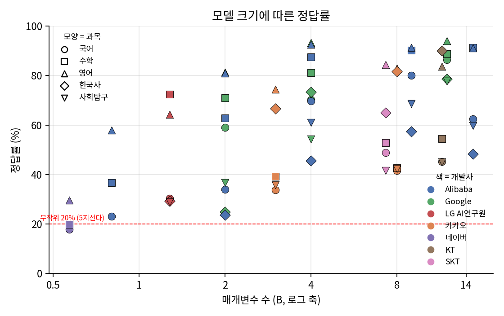

**난이도별: 2·3·4점 문항 정답률**

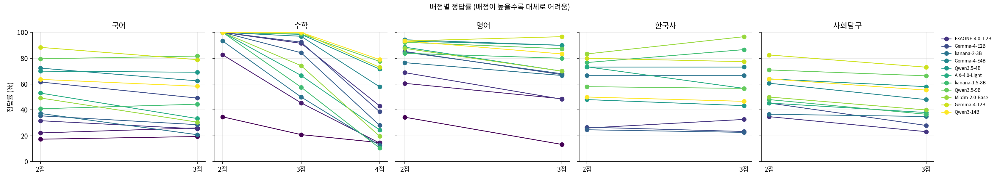

**오답 유형 구성**

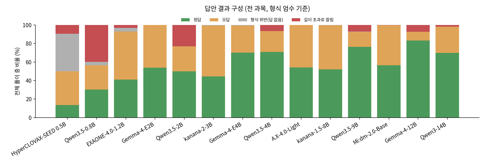

**일관성: 다수결과 답의 안정성**

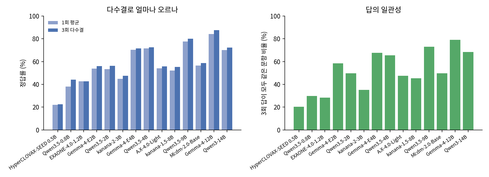

**추론 길이 vs 정답률**

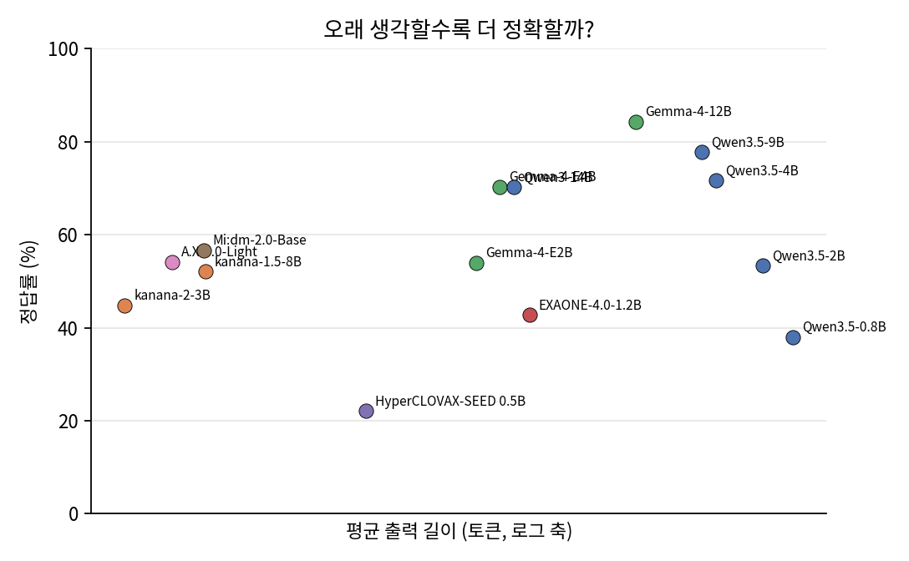

**가장 어려운 15문항**

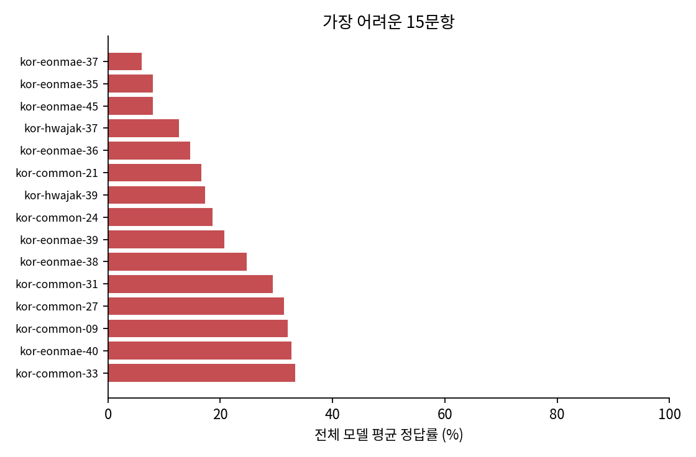

**모든 모델이 3회 모두 틀린 문항**: `math-calc-30`, `math-common-21`

**모든 모델이 3회 모두 맞힌 문항**: `eng-all-20`, `eng-all-24`

## 문항 해설

대표 문항 몇 개를 골라 모델별 풀이 과정을 구체적으로 분석했다: [docs/examples.md](docs/examples.md)

## 원점수

각 문항을 3회 풀게 해 평균 원점수를 냈고, 괄호 안은 3회 중 최저–최고 점수다. 선택과목은 따로 계산했다.
- 국어 = 공통 34문항(76점) + 화법과 작문 또는 언어와 매체(24점), 100점 만점
- 수학 = 공통 22문항(74점) + 확률과 통계 / 미적분 / 기하(26점), 100점 만점
- 영어 = 45문항, 100점 만점
- 한국사와 사회탐구 각 과목 = 20문항, 50점 만점. 사회탐구는 글 중심 과목인 생활과 윤리, 윤리와 사상, 경제, 정치와 법, 사회·문화를 골랐다(지도 의존도가 높은 지리 과목과 과학탐구는 제외).

| 모델 | 개발사 | 매개변수(B) | 실행 가능 기기 | 국어(화작) | 국어(언매) | 수학(확통) | 수학(미적) | 수학(기하) | 영어 | 한국사 <sub>(50점)</sub> | 생활과 윤리 <sub>(50점)</sub> | 윤리와 사상 <sub>(50점)</sub> | 경제 <sub>(50점)</sub> | 정치와 법 <sub>(50점)</sub> | 사회·문화 <sub>(50점)</sub> |
|---|---|---|---|---|---|---|---|---|---|---|---|---|---|---|---|
| HyperCLOVAX-SEED 0.5B | 네이버 | 0.57 | 보급형 스마트폰 | 18.0 <sub>(13–25)</sub> | 18.0 <sub>(16–19)</sub> | 17.5 <sub>(14–21)</sub> | 21.3 <sub>(17–24)</sub> | 18.0 <sub>(15–21)</sub> | 28.1 <sub>(25–30)</sub> | — | — | — | — | — | — |
| Qwen3.5-0.8B | 알리바바 | 0.8 | 보급형 스마트폰 | 24.4 <sub>(18–32)</sub> | 22.9 <sub>(20–28)</sub> | 36.5 <sub>(35–39)</sub> | 36.3 <sub>(33–39)</sub> | 33.5 <sub>(31–36)</sub> | 57.0 <sub>(53–62)</sub> | — | — | — | — | — | — |
| EXAONE-4.0-1.2B | LG AI연구원 | 1.28 | 보급형 스마트폰 | 31.2 <sub>(28–35)</sub> | 31.5 <sub>(27–35)</sub> | 77.6 <sub>(70–82)</sub> | 72.9 <sub>(63–82)</sub> | 73.5 <sub>(71–78)</sub> | 62.7 <sub>(61–64)</sub> | 15.0 <sub>(13–18)</sub> | 19.9 <sub>(11–28)</sub> | 7.3 <sub>(3–10)</sub> | 15.1 <sub>(14–17)</sub> | 13.7 <sub>(7–21)</sub> | 13.5 <sub>(12–16)</sub> |
| Gemma-4-E2B | 구글 | 2.0 | 중급 스마트폰 | 67.9 <sub>(64–71)</sub> | 61.2 <sub>(59–63)</sub> | 75.0 <sub>(72–80)</sub> | 73.0 <sub>(69–77)</sub> | 76.3 <sub>(76–77)</sub> | 79.9 <sub>(78–83)</sub> | 12.3 <sub>(10–14)</sub> | 28.3 <sub>(22–33)</sub> | 12.3 <sub>(9–14)</sub> | 24.0 <sub>(21–27)</sub> | 12.7 <sub>(12–14)</sub> | 10.0 <sub>(9–12)</sub> |
| Qwen3.5-2B | 알리바바 | 2.0 | 보급형 스마트폰 | 33.6 <sub>(31–36)</sub> | 37.7 <sub>(34–42)</sub> | 64.7 <sub>(63–66)</sub> | 59.9 <sub>(56–65)</sub> | 62.1 <sub>(61–63)</sub> | 79.7 <sub>(78–81)</sub> | 11.7 <sub>(10–14)</sub> | — | — | — | — | — |
| kanana-2-3B | 카카오 | 3.0 | 중급 스마트폰 | 32.5 <sub>(30–34)</sub> | 36.0 <sub>(29–40)</sub> | 42.6 <sub>(29–54)</sub> | 38.9 <sub>(28–51)</sub> | 36.3 <sub>(25–49)</sub> | 73.6 <sub>(68–80)</sub> | 33.3 <sub>(27–38)</sub> | 28.3 <sub>(20–33)</sub> | 19.7 <sub>(17–24)</sub> | 12.4 <sub>(10–14)</sub> | 15.7 <sub>(15–16)</sub> | 13.0 <sub>(10–18)</sub> |
| Gemma-4-E4B | 구글 | 4.0 | 중급 스마트폰 | 77.2 <sub>(69–83)</sub> | 73.3 <sub>(67–77)</sub> | 82.7 <sub>(80–84)</sub> | 79.3 <sub>(77–81)</sub> | 88.0 <sub>(84–92)</sub> | 93.0 <sub>(88–98)</sub> | 36.7 <sub>(31–41)</sub> | 32.3 <sub>(29–34)</sub> | 22.0 <sub>(17–28)</sub> | 32.7 <sub>(31–34)</sub> | 28.0 <sub>(22–31)</sub> | 17.7 <sub>(15–23)</sub> |
| Qwen3.5-4B | 알리바바 | 4.0 | 중급 스마트폰 | 75.0 <sub>(71–81)</sub> | 70.7 <sub>(68–72)</sub> | 88.8 <sub>(86–92)</sub> | 85.9 <sub>(82–88)</sub> | 90.5 <sub>(82–96)</sub> | 92.3 <sub>(88–95)</sub> | 22.6 <sub>(20–25)</sub> | 36.7 <sub>(33–40)</sub> | 19.9 <sub>(19–22)</sub> | 40.9 <sub>(38–46)</sub> | 26.7 <sub>(25–29)</sub> | 26.8 <sub>(24–31)</sub> |
| A.X-4.0-Light | SKT | 7.3 | 플래그십 스마트폰 | 52.0 <sub>(50–54)</sub> | 46.3 <sub>(45–47)</sub> | 56.7 <sub>(51–60)</sub> | 55.3 <sub>(52–60)</sub> | 55.3 <sub>(48–63)</sub> | 83.0 <sub>(78–88)</sub> | 31.7 <sub>(27–36)</sub> | 28.3 <sub>(25–32)</sub> | 20.0 <sub>(18–22)</sub> | 19.3 <sub>(17–21)</sub> | 15.0 <sub>(12–18)</sub> | 19.7 <sub>(17–21)</sub> |
| kanana-1.5-8B | 카카오 | 8.0 | 플래그십 스마트폰 | 44.7 <sub>(40–48)</sub> | 45.3 <sub>(44–47)</sub> | 43.0 <sub>(37–49)</sub> | 42.0 <sub>(40–46)</sub> | 41.0 <sub>(34–46)</sub> | 82.7 <sub>(77–89)</sub> | 41.3 <sub>(40–43)</sub> | 31.7 <sub>(26–36)</sub> | 23.3 <sub>(19–29)</sub> | 17.0 <sub>(16–18)</sub> | 15.7 <sub>(15–16)</sub> | 15.3 <sub>(12–20)</sub> |
| Qwen3.5-9B | 알리바바 | 9.0 | 플래그십 스마트폰 | 87.7 <sub>(87–88)</sub> | 79.0 <sub>(76–81)</sub> | 90.4 <sub>(89–93)</sub> | 86.7 <sub>(82–92)</sub> | 92.8 <sub>(90–96)</sub> | 90.9 <sub>(89–93)</sub> | 28.6 <sub>(25–33)</sub> | 42.3 <sub>(40–45)</sub> | 25.8 <sub>(21–33)</sub> | 45.3 <sub>(44–48)</sub> | 28.5 <sub>(24–36)</sub> | 28.5 <sub>(25–34)</sub> |
| Mi:dm-2.0-Base | KT | 11.5 | 노트북·태블릿 | 47.3 <sub>(46–50)</sub> | 41.0 <sub>(37–45)</sub> | 55.3 <sub>(55–56)</sub> | 50.3 <sub>(47–55)</sub> | 54.9 <sub>(51–59)</sub> | 82.3 <sub>(79–87)</sub> | 45.7 <sub>(41–48)</sub> | 30.7 <sub>(29–34)</sub> | 23.3 <sub>(21–25)</sub> | 17.3 <sub>(14–19)</sub> | 21.3 <sub>(17–28)</sub> | 17.3 <sub>(12–24)</sub> |
| Gemma-4-12B | 구글 | 12.0 | 노트북·태블릿 | 91.7 <sub>(88–95)</sub> | 86.2 <sub>(78–93)</sub> | 88.5 <sub>(86–90)</sub> | 81.6 <sub>(82–82)</sub> | 88.5 <sub>(86–90)</sub> | 94.3 <sub>(91–96)</sub> | 39.2 <sub>(35–43)</sub> | 42.8 <sub>(39–47)</sub> | 37.5 <sub>(35–41)</sub> | 45.2 <sub>(40–50)</sub> | 32.2 <sub>(31–34)</sub> | 34.4 <sub>(32–37)</sub> |
| Qwen3-14B | 알리바바 | 14.8 | 노트북·태블릿 | 72.0 <sub>(68–77)</sub> | 64.7 <sub>(64–66)</sub> | 91.7 <sub>(90–96)</sub> | 87.2 <sub>(85–89)</sub> | 92.8 <sub>(93–93)</sub> | 90.3 <sub>(89–93)</sub> | 24.0 <sub>(22–25)</sub> | 38.0 <sub>(35–40)</sub> | 20.3 <sub>(16–24)</sub> | 36.3 <sub>(30–40)</sub> | 25.7 <sub>(23–27)</sub> | 26.7 <sub>(18–36)</sub> |

**국어·수학·영어 원점수**

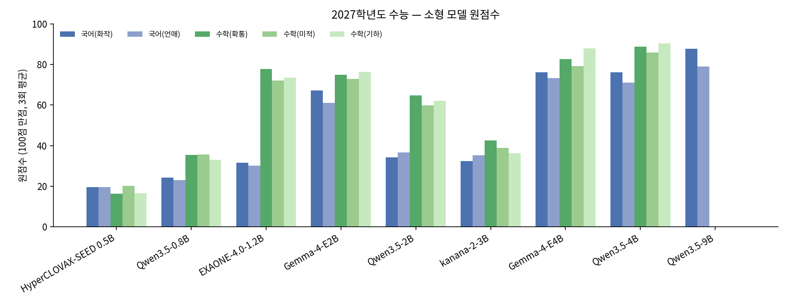

**한국사·사회탐구 원점수**

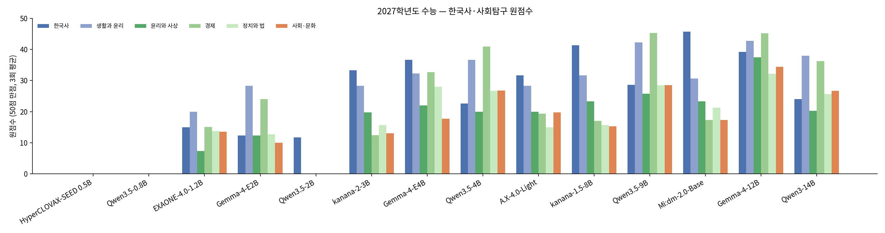

**국어: 크기 vs 점수**

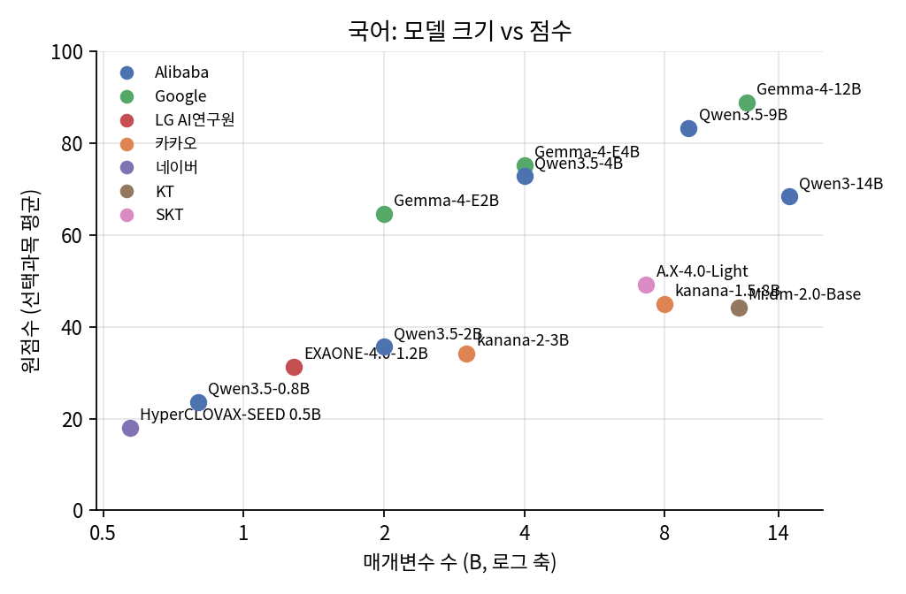

**수학: 크기 vs 점수**

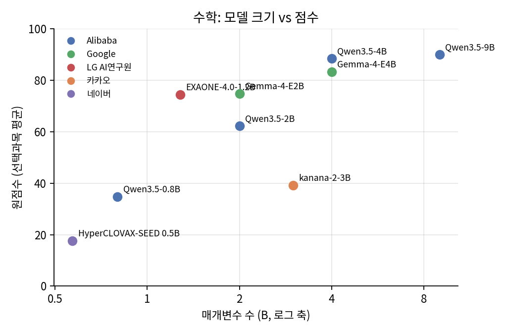

**영어: 크기 vs 점수**

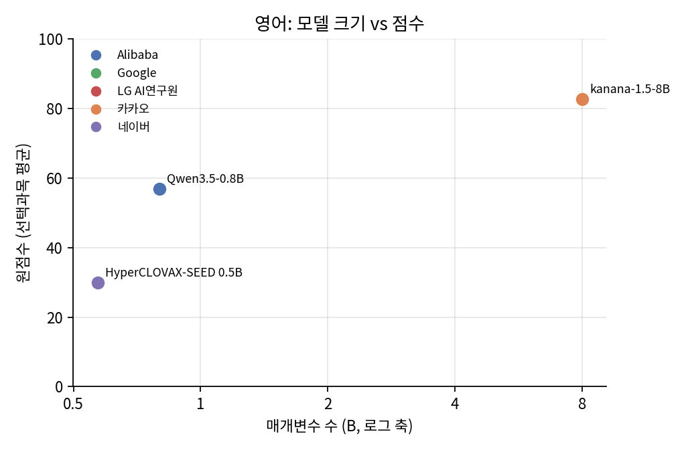

**한국사: 크기 vs 점수**

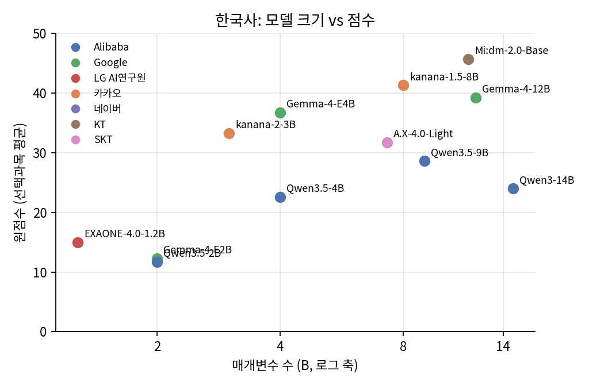

**사회탐구: 크기 vs 점수**

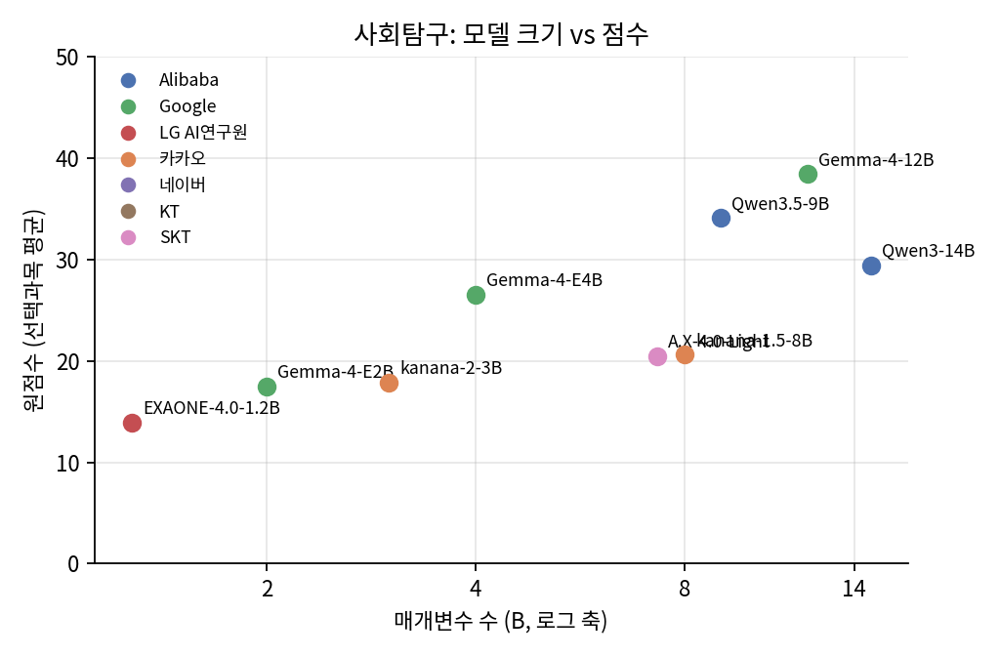

**국어: 문항별 정답률**

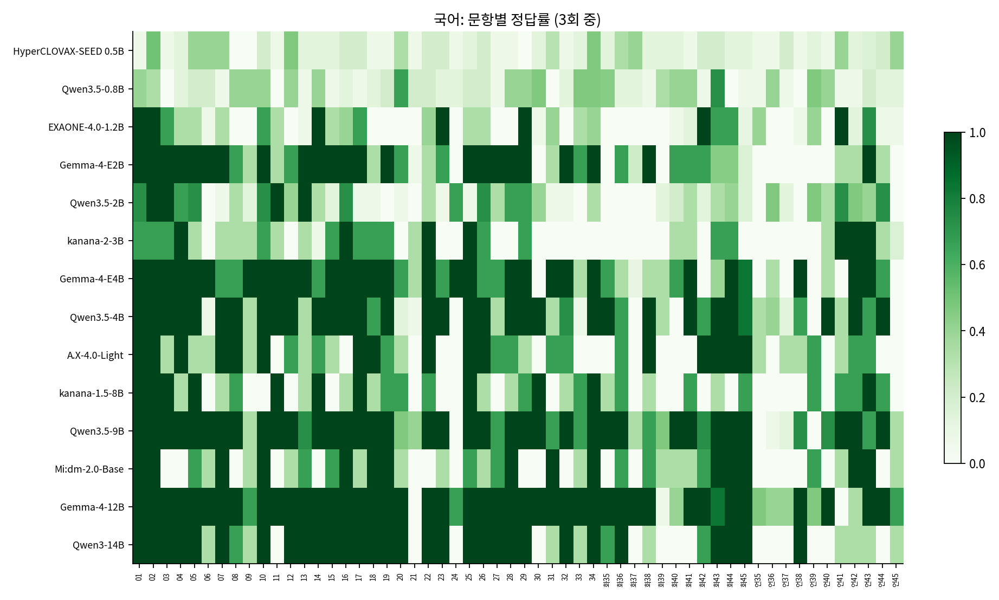

**수학: 문항별 정답률**

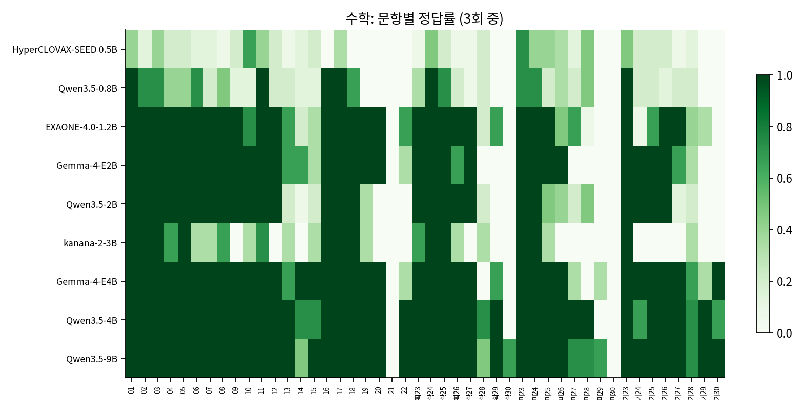

**영어: 문항별 정답률**

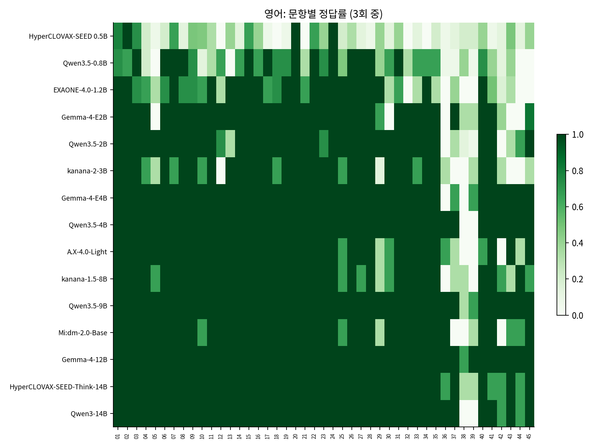

**한국사: 문항별 정답률**

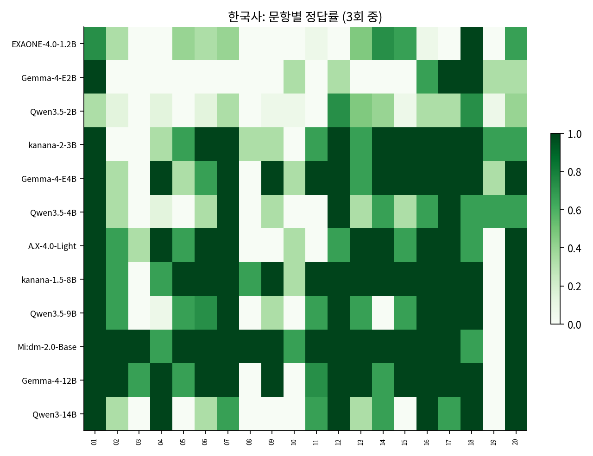

**사회탐구: 문항별 정답률**

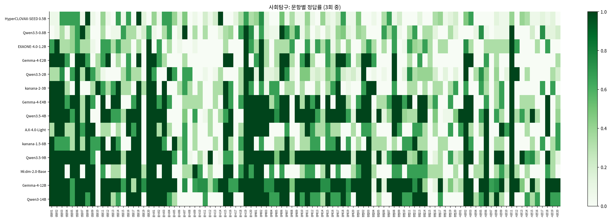

### 채점 보조 지표

- **정제 후**: 답안 형식이 어긋나도 모델이 최종적으로 고른 답을 인정한 정답률(아래 "채점 방식" 참고).
- **형식 엄수**: 마지막 줄에 `정답: X` 형식을 정확히 지킨 답만 인정한 정답률.
- **형식 위반**: `정답: X` 형식을 찾지 못한 비율.
- **잘림**: 생성 길이 상한(16,384 토큰)에 도달해 답을 내지 못하고 끝난 비율.

| 모델 | 국어 정제 후 / 형식 엄수 / 형식 위반 / 잘림 / 평균 토큰 | 수학 정제 후 / 형식 엄수 / 형식 위반 / 잘림 / 평균 토큰 | 영어 정제 후 / 형식 엄수 / 형식 위반 / 잘림 / 평균 토큰 | 한국사 정제 후 / 형식 엄수 / 형식 위반 / 잘림 / 평균 토큰 | 사회탐구 정제 후 / 형식 엄수 / 형식 위반 / 잘림 / 평균 토큰 |
|---|---|---|---|---|---|
| HyperCLOVAX-SEED 0.5B | 0.18 / 0.09 / 0.50 / 0.10 / 946 | 0.20 / 0.10 / 0.59 / 0.09 / 1165 | 0.30 / 0.23 / 0.41 / 0.10 / 1116 | — | — |
| Qwen3.5-0.8B | 0.23 / 0.14 / 0.46 / 0.46 / 12622 | 0.37 / 0.28 / 0.59 / 0.54 / 13733 | 0.58 / 0.54 / 0.18 / 0.18 / 9809 | — | — |
| EXAONE-4.0-1.2B | 0.30 / 0.29 / 0.04 / 0.01 / 1520 | 0.72 / 0.70 / 0.18 / 0.14 / 6924 | 0.64 / 0.61 / 0.06 / 0.00 / 1123 | 0.29 / 0.27 / 0.13 / 0.03 / 1631 | 0.29 / 0.28 / 0.03 / 0.01 / 2341 |
| Gemma-4-E2B | 0.59 / 0.58 / 0.00 / 0.00 / 1897 | 0.71 / 0.71 / 0.00 / 0.00 / 3471 | 0.81 / 0.81 / 0.00 / 0.00 / 1278 | 0.25 / 0.25 / 0.00 / 0.00 / 1140 | 0.37 / 0.37 / 0.00 / 0.00 / 1870 |
| Qwen3.5-2B | 0.34 / 0.29 / 0.23 / 0.25 / 12221 | 0.63 / 0.59 / 0.37 / 0.37 / 10424 | 0.81 / 0.81 / 0.04 / 0.05 / 7274 | 0.24 / 0.18 / 0.27 / 0.27 / 10510 | — |
| kanana-2-3B | 0.34 / 0.33 / 0.00 / 0.00 / 176 | 0.39 / 0.39 / 0.01 / 0.00 / 596 | 0.74 / 0.74 / 0.00 / 0.00 / 135 | 0.67 / 0.67 / 0.00 / 0.00 / 168 | 0.36 / 0.36 / 0.01 / 0.00 / 256 |
| Gemma-4-E4B | 0.70 / 0.69 / 0.02 / 0.00 / 1955 | 0.81 / 0.81 / 0.01 / 0.00 / 3955 | 0.93 / 0.93 / 0.00 / 0.00 / 1105 | 0.73 / 0.73 / 0.00 / 0.00 / 1503 | 0.54 / 0.54 / 0.00 / 0.00 / 2379 |
| Qwen3.5-4B | 0.70 / 0.70 / 0.04 / 0.07 / 8813 | 0.88 / 0.87 / 0.12 / 0.12 / 7250 | 0.93 / 0.92 / 0.01 / 0.00 / 3809 | 0.46 / 0.45 / 0.03 / 0.05 / 8785 | 0.61 / 0.60 / 0.05 / 0.07 / 9120 |
| A.X-4.0-Light | 0.49 / 0.49 / 0.00 / 0.00 / 269 | 0.53 / 0.53 / 0.00 / 0.00 / 741 | 0.84 / 0.84 / 0.00 / 0.00 / 196 | 0.65 / 0.65 / 0.00 / 0.00 / 245 | 0.42 / 0.42 / 0.00 / 0.00 / 315 |
| kanana-1.5-8B | 0.42 / 0.42 / 0.00 / 0.00 / 343 | 0.43 / 0.43 / 0.01 / 0.00 / 857 | 0.83 / 0.83 / 0.00 / 0.00 / 217 | 0.82 / 0.82 / 0.00 / 0.00 / 246 | 0.42 / 0.42 / 0.00 / 0.00 / 409 |
| Qwen3.5-9B | 0.80 / 0.79 / 0.07 / 0.07 / 7616 | 0.90 / 0.89 / 0.11 / 0.11 / 7024 | 0.91 / 0.91 / 0.01 / 0.01 / 3250 | 0.57 / 0.57 / 0.03 / 0.03 / 8780 | 0.69 / 0.67 / 0.08 / 0.09 / 8504 |
| Mi:dm-2.0-Base | 0.45 / 0.45 / 0.00 / 0.00 / 361 | 0.55 / 0.54 / 0.01 / 0.01 / 851 | 0.84 / 0.84 / 0.00 / 0.00 / 251 | 0.90 / 0.90 / 0.00 / 0.00 / 265 | 0.45 / 0.45 / 0.00 / 0.00 / 371 |
| Gemma-4-12B | 0.86 / 0.86 / 0.05 / 0.05 / 5240 | 0.89 / 0.88 / 0.12 / 0.12 / 6271 | 0.94 / 0.94 / 0.00 / 0.00 / 1211 | 0.79 / 0.78 / 0.02 / 0.02 / 3103 | 0.78 / 0.76 / 0.11 / 0.11 / 6245 |
| Qwen3-14B | 0.62 / 0.62 / 0.00 / 0.00 / 1395 | 0.91 / 0.90 / 0.10 / 0.09 / 4721 | 0.91 / 0.91 / 0.00 / 0.00 / 635 | 0.48 / 0.48 / 0.00 / 0.00 / 1561 | 0.60 / 0.60 / 0.00 / 0.00 / 3066 |

## 평가 방법

| 항목 | 설정 |
|---|---|
| 문항 | 2027학년도 대학수학능력시험 홀수형, 시험 당일 공개된 문제지와 정답표(가답안) |
| 국어 | PDF에서 2단 순서대로 텍스트를 추출했다. 메신저 화면·표·옛한글이 이미지로 들어간 쪽은 시각 언어 모델(Qwen3.8-27B)로 전사한 뒤 원본과 대조해 고쳤다. 각 문항에는 해당 지문 세트 전체(지문 + 같은 세트의 문항들)를 함께 제시했다. |
| 수학 | 수식 글꼴이 텍스트로 추출되지 않아 시각 언어 모델로 LaTeX 전사하고 그림은 글로 설명했다. 46문항 전부를 원본 이미지와 대조해 오류 3건을 바로잡았다. |
| 영어 | 지문은 PDF에서 추출하고, 듣기(1–17번)는 음성 대신 공식 듣기 대본을 제공했다. |
| 한국사·사회탐구 | 사진·지도·도표가 많아 쪽 전체를 시각 언어 모델로 전사하고(표는 표로, 그래프·그림은 글로), 글자 부분은 PDF 텍스트와 한 줄씩 대조해 오독을 고쳤다(예: '균역법'이 '군역법'으로, ㉠이 ⑦로 읽힌 경우). 각 문항은 자기 자료와 선택지만으로 풀 수 있게 구성했다. |
| 풀이 | vLLM, GPU 1장. 각 모델의 기본 생성 설정을 썼고, 추론(thinking) 모드가 있는 모델은 켰다. 문항마다 3회 풀이, 최대 16,384 토큰. |
| 채점 방식 | 답안 끝의 최종 답을 정답표와 비교해 배점(2/3/4점)대로 합산했다. 형식이 어긋난 답안은 별도 모델이 "응시자가 최종적으로 고른 답"만 읽어 냈다(정답 여부는 판단하지 않음). 답을 여러 개 적으면 그중 하나를 고른 것으로 보고 기대 점수를 주었고(예: 2개 중 하나가 정답이면 1/2), 5지선다형에 답을 적지 못한 경우는 무작위로 마킹한 것으로 보아 20%를 주었다. 단답형 무응답은 0점이다. |

Gemma-4 E2B/E4B의 매개변수는 공식 표기인 유효 매개변수(effective) 기준이다.

## 한계

- 정답은 시험 당일 공개된 **가답안**이다. 최종 정답은 12월 1일 평가원 발표를 따른다.
- 모델은 시험지 이미지가 아니라 텍스트 전사본을 읽었다. 밑줄·박스 같은 편집 정보 일부가 사라졌고, 그림은 글로만 전달되므로 기하 문항이 특히 영향을 받는다.
- 영어 듣기는 음성이 아니라 대본으로 풀었기 때문에 실제보다 쉽다.
- 한국사·사회탐구의 사진, 지도, 그래프는 글로 옮긴 설명만 제공했다. 그림 속 정보를 읽어 내는 능력은 평가하지 않았고, 설명 과정에서 정보가 빠졌을 수 있다.
- 원점수만 제시했다. 표준점수와 등급은 공식 채점 결과가 발표된 뒤에야 알 수 있다.

## 재현

```bash
python scripts/fetch_exam.py                # 평가원에서 문제지·정답표 내려받기
python scripts/build_korean.py              # 국어 문항 구성 (build_math.py, build_english.py, build_social.py도 같은 방식)
python eval/run_eval.py <hf_model> data/korean.json,data/math.json,data/english.json,data/history.json,data/social.json results/raw
python eval/extract_answers.py results/raw  # 형식이 어긋난 답안의 최종 답 정제
python scripts/make_report.py               # results/, figures/, README 생성
```

문제의 저작권은 한국교육과정평가원에 있다. 이 저장소에는 코드, 점수, 문항별 정오만 담았고 문제 원문·전사본·모델 답안 원문은 넣지 않았다. 재현할 때는 평가원 누리집에서 직접 내려받으면 된다.
